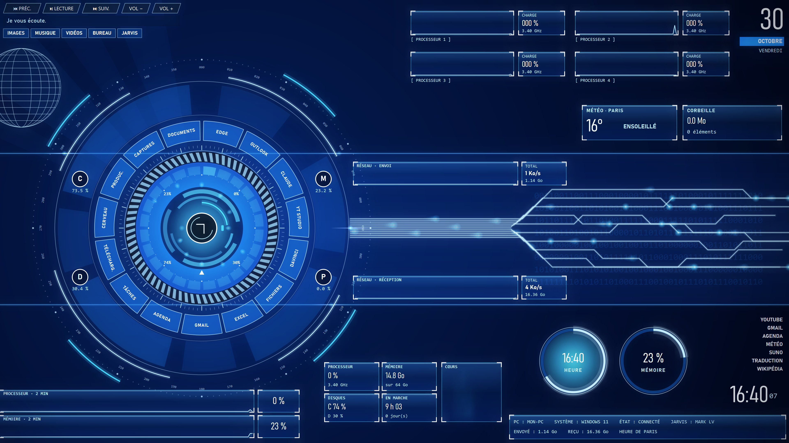
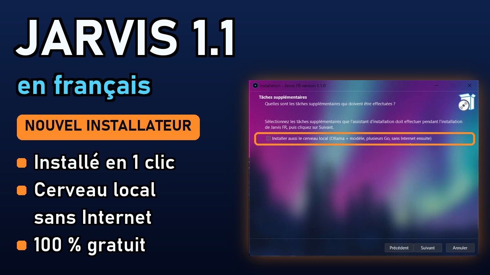

<div align="center">

# J.A.R.V.I.S — Mark LV · Édition française

**Un assistant vocal pour Windows qui écoute, parle, voit ton écran, pilote ton PC et se souvient de toi.**
Interface holographique en 4K, mémoire à long terme et un « second cerveau » relié à Claude Code.




*Version française améliorée et non officielle de [**Mark LV**](https://www.youtube.com/@FatihMakes), le Jarvis open source de **FatihMakes**.*

### 📺 [Le tuto vidéo : installer Jarvis pas à pas (4 min)](https://youtu.be/9UM3858yk6A)

[](https://youtu.be/9UM3858yk6A)

### 🔜 Bientôt : la version 1.1 (en cours de développement)

Une nouvelle version de Jarvis FR est en préparation. Sa grande nouveauté : **le cerveau en hologramme**.

Dis « *Jarvis, montre-moi le cerveau en hologramme* » : tes dossiers apparaissent sous forme de bulles lumineuses bleues, que tu peux **manipuler avec les gestes de la main** devant ta webcam. Tu peux les attraper, les lancer, les ouvrir, et écarter les deux mains pour zoomer.

- 🎥 **Avec une webcam :** c'est là que l'hologramme prend tout son sens, on le pilote vraiment à la main.
- 🖱️ **Sans webcam :** tout reste possible à la souris.

La version 1.1 sortira dès qu'elle aura été bien testée. Pour suivre sa sortie, clique sur ⭐ **Star** ou 👁️ **Watch** en haut de cette page.

</div>

---

## Sommaire

- [Avant de commencer : Obsidian et ta clé Gemini](#-avant-de-commencer--obsidian-et-ta-clé-gemini)
- [Installation en une ligne](#-installation-en-une-ligne)
- [Premier lancement](#-premier-lancement)
- [Ce que sait faire Jarvis](#-ce-que-sait-faire-jarvis)
- [Le second cerveau (Claude Code)](#-le-second-cerveau-claude-code)
- [Brancher Gmail](#-brancher-gmail)
- [Réglages](#%EF%B8%8F-réglages)
- [Installation manuelle](#-installation-manuelle)
- [Dépannage](#-dépannage)
- [Ce qui change par rapport à Mark LV](#-ce-qui-change-par-rapport-à-mark-lv)
- [Crédits et licences](#-crédits-et-licences)

---

## 🔑 Avant de commencer : Obsidian et ta clé Gemini

Deux choses à préparer **avant** l'installation (5 minutes en tout).

### 1. Installer Obsidian (pour le cerveau)

Le cerveau de Jarvis est un carnet de pages qu'on lit avec **Obsidian**, gratuit.

1. Va sur **[obsidian.md](https://obsidian.md)** et clique sur **« Download »**.
2. Installe-le comme n'importe quel programme (suivant, suivant, terminer).
3. Ne l'ouvre pas encore : l'installation de Jarvis va créer le cerveau dans `Documents\Cerveau`, et tu l'ouvriras ensuite (voir [Le second cerveau](#-le-second-cerveau-claude-code)).

### 2. Récupérer ta clé Gemini

Jarvis parle grâce à **Google Gemini**. Il lui faut une clé, **gratuite** :

1. Va sur **[aistudio.google.com/apikey](https://aistudio.google.com/apikey)** et connecte-toi avec ton compte Google.
2. Clique sur **« Create API key »** (*Créer une clé API*).
3. **Copie la clé** : elle commence par `AIza…` (ancien format) ou par `AQ.…` (nouveau format).

L'installation te la demandera à la fin : il suffira de la coller. Elle reste **uniquement sur ton PC** (`config\api_keys.json`, jamais partagée). Pour la changer plus tard : double-clique sur **`Changer-Cle-Gemini.bat`** dans le dossier de Jarvis.

> Ne donne jamais ta clé à quelqu'un et ne la publie nulle part : c'est comme un mot de passe.

---

## ⚡ Installation en une ligne

1. Ouvre le menu Démarrer, tape **PowerShell**, puis ouvre-le.
2. Colle cette ligne et appuie sur **Entrée** :

```powershell
irm https://raw.githubusercontent.com/fredo-jarvis/jarvis-fr/main/installer.ps1 | iex
```

Le script fait tout, dans l'ordre :

| Étape | Ce qui se passe |
|---|---|
| 1 | Installe **Python 3.12** s'il manque (avec `winget`, l'outil officiel de Windows) |
| 2 | Télécharge Jarvis dans `%USERPROFILE%\Jarvis-Mark-LV` |
| 3 | Crée son environnement Python et installe ses bibliothèques (quelques minutes) |
| 4 | Crée un **cerveau vierge** dans `Documents\Cerveau`, avant le premier lancement |
| 5 | Pose un raccourci **Jarvis** sur le bureau |
| 6 | Ouvre la page Google et te demande de **coller ta clé Gemini** |

> Relancer la même ligne **met Jarvis à jour** sans toucher à ta clé, à ta mémoire ni à ton cerveau.

> Si Windows bloque le script : `Set-ExecutionPolicy -Scope CurrentUser RemoteSigned`, puis recommence.

---

## 🚀 Premier lancement

1. **Double-clique sur « Jarvis »** sur le bureau.
2. **La clé Gemini** : déjà collée pendant l'installation. Si tu l'as passée, Jarvis te la demande ici (voir [Avant de commencer](#-avant-de-commencer--obsidian-et-ta-clé-gemini)).
3. **Le micro et les haut-parleurs** : choisis-les dans la liste.
4. **Faire connaissance** : Jarvis se présente, puis te pose ses questions **une par une**. Ton prénom, comment il doit t'appeler (tu ou vous), ta ville pour la météo, ton travail, ce que tu aimes, tes projets et ton adresse Gmail. Tu peux passer n'importe quelle question. Il garde chaque réponse dans sa **mémoire** et, au même moment, dans le **carnet du cerveau**.

Ensuite, parle-lui simplement : « Jarvis, ouvre YouTube », « quel temps fait-il ? », « lis-moi mes mails »…
Pour le fermer : « Jarvis, ferme-toi », « éteins-toi », « arrête-toi » ou « au revoir Jarvis ». Il dit au revoir, une seule fois, puis se ferme.

### 📁 Où sont les fichiers

Remplace `TON-NOM` par ton nom de session Windows (celui qui apparaît dans `C:\Users\`) :

| Quoi | Chemin |
|---|---|
| **Jarvis** (le programme) | `C:\Users\TON-NOM\Jarvis-Mark-LV` |
| **Le cerveau** (à ouvrir dans Obsidian) | `C:\Users\TON-NOM\Documents\Cerveau` |
| Les pages du cerveau | `C:\Users\TON-NOM\Documents\Cerveau\wiki` |
| La fiche lue par Jarvis à chaque démarrage | `C:\Users\TON-NOM\Documents\Cerveau\wiki\fiche-cerveau.md` |
| Le carnet où Jarvis écrit ce qu'il apprend | `C:\Users\TON-NOM\Jarvis-Mark-LV\memory\carnet-cerveau.md` |
| Sa mémoire (prénom, goûts, projets) | `C:\Users\TON-NOM\Jarvis-Mark-LV\memory\long_term.json` |
| Tes réglages | `C:\Users\TON-NOM\Jarvis-Mark-LV\memory\interface.json` |
| Ta clé Gemini et Gmail (secret, jamais partagé) | `C:\Users\TON-NOM\Jarvis-Mark-LV\config\api_keys.json` |

> Astuce : colle `%USERPROFILE%\Documents\Cerveau` dans la barre d'adresse de l'Explorateur pour ouvrir le cerveau directement.

---

## 🧠 Ce que sait faire Jarvis

### La voix et la conversation
| | |
|---|---|
| 🎙️ **Conversation en temps réel** | Il parle et comprend le français (et toutes les langues), avec un temps de réponse très court grâce à Gemini Live |
| ✋ **Couper la parole** | Tu peux lui parler pendant qu'il répond : il se tait et t'écoute |
| 🔔 **Mot d'éveil** | « Hey Jarvis » le réveille ; il se rendort après deux minutes de silence |
| 🎚️ **Appuyer pour parler** | Garde **Ctrl+Espace** enfoncé pour ouvrir le micro, si tu préfères |
| 💬 **Il prend l'initiative** | De temps en temps, il prend des nouvelles, propose la suite d'un projet ou raconte une actu |
| 😄 **Mode humour** | « Jarvis, sois drôle » : une remarque pince-sans-rire à la fin de ses réponses, jamais sur un sujet sérieux |
| 🗣️ **Avocat du diable** | Avant une grosse décision (un achat, une publication), il te donne trois objections, puis te demande si tu y vas quand même |

### La mémoire
| | |
|---|---|
| 🤝 **Première rencontre** | Au premier lancement, il fait connaissance avec toi, étape par étape |
| 🧠 **Mémoire à long terme** | Il retient ce que tu lui apprends (prénom, goûts, projets, proches) d'une séance à l'autre |
| 🗓️ **Résumé des séances** | Il résume chaque conversation et s'en souvient le lendemain |
| 📒 **Second cerveau** | Il lit ton wiki personnel, y cherche des réponses et y dépose des notes (voir plus bas) |
| ✅ **Promesses et décisions** | Quand tu dis « il faut que je… », il le note dans le carnet du cerveau pour qu'on te le rappelle |

### Le PC
| | |
|---|---|
| 🖥️ **Ouvrir n'importe quoi** | Applications, dossiers, fichiers, sites : il retrouve tout par son nom |
| ⚙️ **Réglages** | Volume, luminosité, Wi-Fi, fenêtres, bureau, raccourcis clavier |
| 📂 **Fichiers** | Il lit, résume et répond aux questions sur tes PDF, Word, Excel ou PowerPoint ; il peut créer, renommer et ranger des fichiers |
| ↩️ **Annuler** | Il peut défaire ce qu'il a fait (fichier déplacé, renommé, créé) |
| ⚠️ **Vraie confirmation** | Éteindre, redémarrer ou couper le Wi-Fi attendent que **tu** cliques sur un bouton |
| ✍️ **Dictée** | Il crée un fichier texte et écrit dedans ce que tu dictes |
| 📊 **Surveillance** | Processeur, mémoire, carte graphique, températures, avec une alerte vocale en cas de souci |
| ⏰ **Rappels** | De vraies notifications Windows à l'heure dite |
| 🎥 **Enregistrer l'écran** | « Jarvis, enregistre mon écran » (pause, reprise, arrêt), idéal pour les tutos |
| 👆 **Montre-moi où cliquer** | Il fait une capture, repère les boutons et te les entoure avec des numéros |

### Internet et médias
| | |
|---|---|
| 🔍 **Recherche web** | Actus, recherches, prix, comparaisons, avec les sources |
| 🌤️ **Météo** | Celle de ta ville, à la voix et sur l'écran |
| ▶️ **YouTube à la voix** | Lecture, pause, vidéo suivante, avancer, sous-titres, passer la pub, sans rien dépenser en jetons |
| 📺 **Vidéos dans l'écran** | « Mets la bande-annonce de… » : la vidéo s'affiche au centre de l'interface |
| 🌐 **Navigateur** | Ouvrir des pages, des onglets et naviguer à la voix |
| 📧 **Gmail** | Nouveaux mails, recherche et lecture à voix haute (lecture seule) |
| 👁️ **Il voit ton écran** | Capture d'écran ou webcam, pour t'aider sur ce que tu regardes |

### L'interface
| | |
|---|---|
| 🔵 **Grand cercle bleu** | Une interface holographique en 4K. Le cœur s'allume quand il écoute ou parle, et des lumières filent dans les circuits |
| 🖱️ **Tout est cliquable** | Les programmes et les dossiers sont dans la couronne du cercle ; la musique, les sites, la météo et la corbeille autour |
| 📈 **Vrais chiffres du PC** | Processeur par cœur, mémoire, disques, réseau, temps de marche, en direct |
| 🧘 **Mode calme** | Rien ne bouge à part les lumières, pour ne pas fatiguer les yeux |
| 📱 **Télécommande** | Pilote Jarvis depuis ton téléphone (QR code) |

---

## 📒 Le second cerveau (Claude Code)

Le cerveau est un **wiki personnel** : un dossier de pages Markdown (`Documents\Cerveau`), que l'installation crée **vide** avant le premier lancement. Deux assistants s'en occupent :

- **Jarvis** (la voix) lit la *fiche du cerveau* à chaque démarrage, cherche et lit les pages quand tu lui poses une question, et écrit ses notes dans un **carnet**. Il ne touche jamais aux pages du wiki.
- **Claude Code** (l'écrit) range les notes du carnet, écrit et relie les pages, et tient la fiche à jour.

### Installer le cerveau, étape par étape

1. **Le dossier est déjà là** : `Documents\Cerveau`, avec ses règles (`CLAUDE.md`) et un wiki vide (`wiki/index.md`, `wiki/log.md`, `wiki/fiche-cerveau.md`).
2. **L'ouvrir dans Obsidian** (installé avant l'installation de Jarvis) : lance Obsidian, clique sur **« Ouvrir un dossier comme coffre »** (*Open folder as vault*), puis choisis `C:\Users\TON-NOM\Documents\Cerveau`. La vue en graphe montre toutes tes pages reliées.
3. **Pour le faire vivre** : installe [Claude Code](https://claude.com/claude-code) (application de bureau ou terminal), puis ouvre-le **dans le dossier `Documents\Cerveau`**. Il lit `CLAUDE.md` tout seul et sait quoi faire.
4. **À chaque séance**, dis-lui simplement : *« Range le carnet de Jarvis et mets la fiche à jour. »* Il range les notes de Jarvis (`Jarvis-Mark-LV\memory\carnet-cerveau.md`) dans les bonnes pages.
5. **Pour lui apprendre des choses** : dépose un document dans `Cerveau\sources-brute\` et dis à Claude Code : *« Ajoute cette source au cerveau. »*

> Le cerveau est ailleurs ? Mets son chemin dans `memory\interface.json` : `"cerveau": "D:\\MonCerveau"`.

---

## 📧 Brancher Gmail

Jarvis lit tes mails **en lecture seule** : il ne peut ni envoyer, ni effacer, ni déplacer un mail.

1. Active la **validation en deux étapes** sur ton compte Google.
2. Dans le dossier de Jarvis, double-clique sur **`Brancher-Gmail.bat`**.
3. La page Google des *mots de passe d'application* s'ouvre. Crée-en un nommé « Jarvis » (16 lettres).
4. Tape ton adresse Gmail, puis colle ce mot de passe d'application. **Ce n'est pas ton vrai mot de passe.**
5. Relance Jarvis : « Jarvis, j'ai des nouveaux mails ? »

Le mot de passe d'application reste sur ton PC (`config/api_keys.json`). Pour couper l'accès, supprime-le sur la même page Google.

---

## 🛠️ Réglages

Tout se règle dans `memory\interface.json` (bloc-notes suffit), puis on relance Jarvis :

| Réglage | Exemple | Rôle |
|---|---|---|
| `ville`, `latitude`, `longitude` | `"Lyon"`, `45.76`, `4.83` | La ville de la météo |
| `ecran` | `"BenQ"` | Ouvrir Jarvis sur l'écran dont le nom contient ce mot (vide = écran principal) |
| `calme` | `true` | `true` : rien ne bouge à part les lumières ; `false` : le cercle tourne très lentement |
| `casque` | `false` | `true` si tu portes un casque (permet de couper la parole à Jarvis) |
| `cerveau` | `""` | Chemin du cerveau (vide = `Documents\Cerveau`) |
| `musique_demarrage` | `true` | Joue la musique posée dans `assets\musique-demarrage\` à l'ouverture |

Le nom de l'assistant, ton nom, sa voix et sa couleur se changent aussi depuis l'interface (**⚙ SETUP**).
Raccourcis : **F2** change d'écran, **F11** passe en fenêtre, **F4** coupe le micro.

---

## 📦 Autre façon : télécharger le ZIP

Si tu préfères ne rien coller dans PowerShell :

1. En haut de cette page, clique sur le bouton vert **« <> Code »**, puis sur **« Download ZIP »**.
2. Ouvre ton dossier **Téléchargements**, fais un clic droit sur le fichier ZIP → **« Extraire tout… »** → **Extraire**.
3. Ouvre le dossier extrait et double-clique sur **`Installer-Jarvis.bat`**.
4. Si Windows affiche « Windows a protégé votre ordinateur », clique sur **« Informations complémentaires »** puis **« Exécuter quand même »** (le fichier vient de GitHub, Windows prévient par habitude).
5. La même installation se lance : Python, bibliothèques, cerveau, raccourci, clé Gemini. Jarvis reste installé **dans ce dossier** : ne le supprime pas ensuite.

---

## 🧰 Installation manuelle

Pour ceux qui préfèrent tout faire à la main :

```powershell
git clone https://github.com/fredo-jarvis/jarvis-fr.git Jarvis-Mark-LV
cd Jarvis-Mark-LV
py -3.12 -m venv .venv
.venv\Scripts\python.exe -m pip install -r requirements.txt
.venv\Scripts\python.exe -m playwright install chromium
Copy-Item cerveau-modele "$([Environment]::GetFolderPath('MyDocuments'))\Cerveau" -Recurse
.\Lancer-Jarvis.bat
```

Vérifier que tout va bien : `.venv\Scripts\python.exe -m unittest discover tests`

---

## 🩺 Dépannage

| Problème | Solution |
|---|---|
| « Python n'a pas pu être installé » | Installe Python 3.12 depuis [python.org](https://www.python.org/downloads/) (coche *Add to PATH*), puis relance la ligne d'installation |
| Le script est bloqué | `Set-ExecutionPolicy -Scope CurrentUser RemoteSigned` |
| Jarvis ne m'entend pas | ⚙ SETUP → choisis le bon micro ; vérifie que **F4** ne l'a pas coupé |
| Il se répond à lui-même | Avec des haut-parleurs, laisse `"casque": false` |
| « Gmail refuse la connexion » | Relance `Brancher-Gmail.bat` avec un nouveau mot de passe d'application |
| Il ne trouve pas le cerveau | Vérifie que `Documents\Cerveau\wiki\fiche-cerveau.md` existe, ou règle `"cerveau"` |

---

## 🔄 Ce qui change par rapport à Mark LV

Cette édition reprend tout le moteur de Mark LV et ajoute :

- **Tout en français** : la voix, les phrases, les commandes et la documentation.
- **Une nouvelle interface** : le grand cercle bleu en 4K, avec un effet néon, des circuits vivants, des raccourcis cliquables, les vrais chiffres du PC et un mode calme.
- **Le second cerveau** relié à Claude Code, avec un modèle vierge et une installation guidée.
- **La première rencontre** : Jarvis fait connaissance, étape par étape.
- **Gmail** en lecture seule, branché en un double-clic.
- **L'installation en une ligne**, et la mise à jour avec la même ligne.
- **De nouvelles compétences** : mode humour, enregistreur d'écran, « montre-moi où cliquer », contrôle de YouTube, dictée, ouverture de n'importe quoi par son nom, promesses, décisions et avocat du diable.

La documentation d'origine (en anglais) est gardée dans [`docs/README-original-FatihMakes.md`](docs/README-original-FatihMakes.md).

---

## 🙏 Crédits et licences

| Projet | Auteur | Licence | Utilisation |
|---|---|---|---|
| [**Mark LV — JARVIS**](https://www.youtube.com/@FatihMakes) | **FatihMakes** | CC BY-NC 4.0 | Le projet d'origine : tout le moteur de Jarvis |
| Idée du « mode acide » (*modo ácido*) | jgm-source / jarvis-opensource | — | Inspiration du mode humour (code réécrit) |
| [jarvis-plugins](https://github.com/upgraderguy777/jarvis-plugins) : enregistreur d'écran, « montre-moi où cliquer » | upgraderguy777 | MIT | Adaptés en français |
| Contrôle de YouTube | Gemind | MIT | Adapté en français |
| [PyQt6](https://www.riverbankcomputing.com/software/pyqt/) | Riverbank Computing | GPL v3 | L'interface |
| [google-genai](https://github.com/googleapis/python-genai) | Google | Apache 2.0 | Gemini et Gemini Live |
| [psutil](https://github.com/giampaolo/psutil) | Giampaolo Rodola | BSD-3 | Les chiffres du PC |
| [yt-dlp](https://github.com/yt-dlp/yt-dlp) | yt-dlp | Unlicense | Les vidéos dans l'écran |
| [Playwright](https://github.com/microsoft/playwright-python) | Microsoft | Apache 2.0 | Le pilotage du navigateur |
| [Open-Meteo](https://open-meteo.com) | Open-Meteo | CC BY 4.0 (données) | La météo |

La liste complète des bibliothèques est dans [`requirements.txt`](requirements.txt).

### Licence

Ce projet est une **œuvre dérivée** de *Mark LV — JARVIS* © 2026 **FatihMakes**, sous licence [Creative Commons Attribution - Pas d'Utilisation Commerciale 4.0](https://creativecommons.org/licenses/by-nc/4.0/deed.fr). Les modifications de cette édition sont distribuées sous la même licence (voir [`LICENSE`](LICENSE)).

- ✅ Tu peux l'utiliser, le modifier et le partager **gratuitement**, en citant FatihMakes et cette édition.
- ❌ **Interdit de le vendre** ou de l'utiliser à des fins commerciales.

Cette édition n'est **pas officielle** : elle n'est ni produite ni approuvée par FatihMakes.

### Tes données

Rien ne part ailleurs que chez Google Gemini (pour la conversation) et, si tu les branches, Gmail et Open-Meteo. Ta clé, ta mémoire, ton cerveau et tes mails restent **sur ton PC**. Le fichier `.gitignore` empêche de les publier par erreur.
